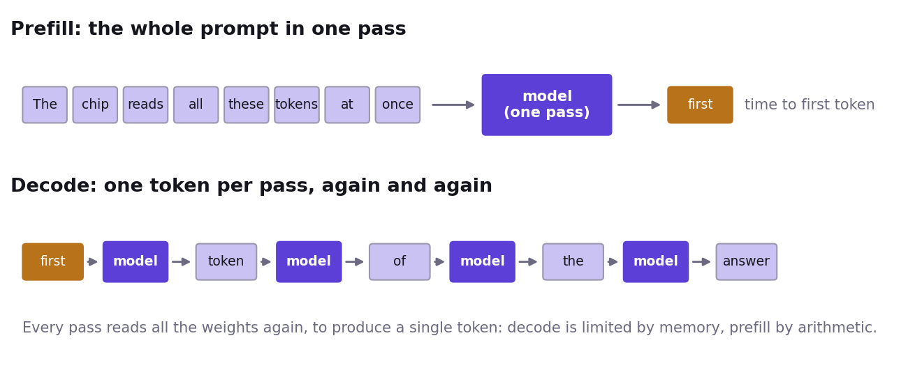

# What you notice when you chat with a model

- You press Enter. For a moment, nothing happens.
- Then the answer arrives one piece at a time, at a steady pace.
- These are two different jobs. This morning you will measure both.

# Words you will hear all morning

- **Token**: a piece of text, usually a word or part of a word. Models read and write tokens.
- **Time to first token (TTFT)**: from sending the prompt to the first token of the answer.
- **Tokens per second per user**: how fast the answer arrives once it has started.

# Phase one: prefill

- The model reads the **whole prompt in one pass** and builds its internal state (the KV cache: Act II).
- In every layer, a matrix of all prompt tokens is multiplied by the layer's weights.
- The weights are read from memory **once**, and used for every token of the prompt.
- Prefill decides the **time to first token**.

# Phase two: decode

- The answer is written **one token at a time**.
- Each new token needs a **full pass** through the model, for that one token.
- Every weight is read from memory again, and used for just one multiplication and one addition.
- Decode decides the **tokens per second**.

# Prefill and decode, side by side

# Compute-bound and memory-bound

- **Compute-bound**: the time is set by how much arithmetic the cores have to do.
- **Memory-bound**: the time is set by how many bytes have to travel from memory to the cores.
- Before a core can use a weight, the weight has to travel from memory (DRAM) to the core.
- **Prefill** uses each weight hundreds of times once it arrives, so the arithmetic takes most of the time: **compute-bound**.
- **Decode** uses each weight once, so most of the time goes into waiting for the next weight: **memory-bound**.
- Same model, same chip, two different limits.

# A speed limit you can work out on a napkin

- At one user, each decode step reads all the weights once.
- minimum time per token = bytes read per step ÷ memory bandwidth
- Example: 1.8 GB read per token ÷ 288 GB/s (one n150) ≈ 6.2 ms, so at most about 160 tokens per second.
- For one user and these number formats, a program that reads every weight once per token can only get closer to it.
- Smaller formats, batching and speculative decoding move the limit itself: Act III and Talk 3.
- The same formula works for any accelerator, GPUs included.

# Act I

- Your model answers a question.
- Time both phases against prompt length.
- Work out the speed limit for your model on your card, and compare.
