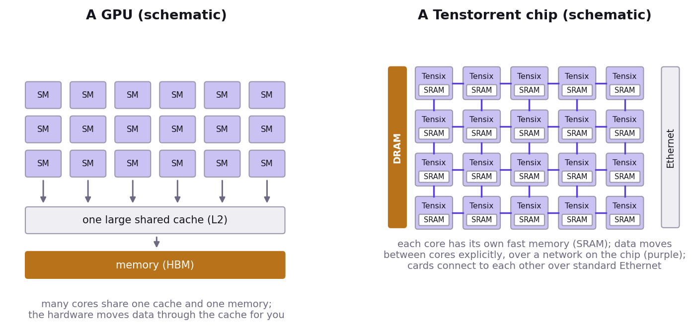
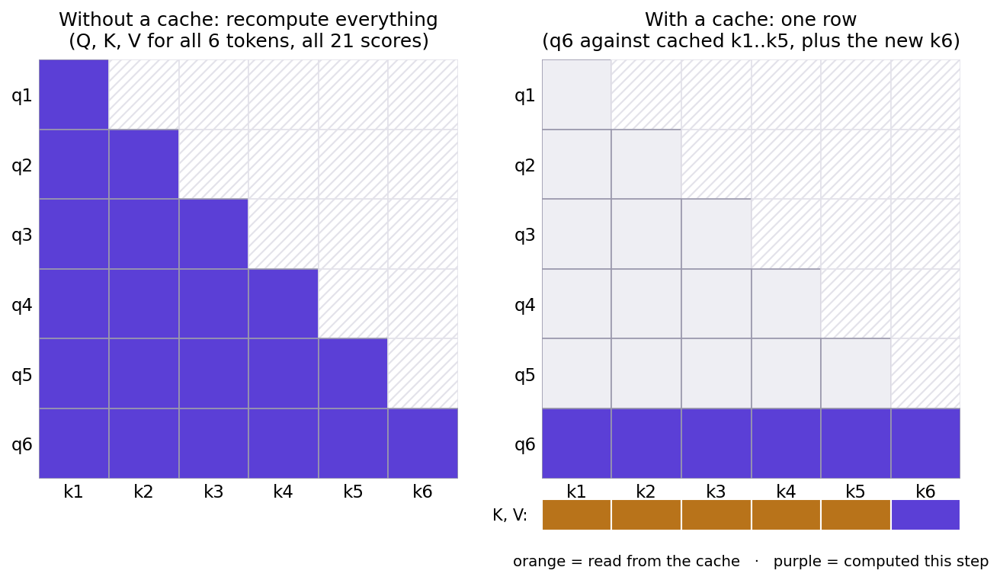

# What is behind your notebook

- A Tenstorrent **Wormhole n150** card.
- A grid of **Tensix cores**. Each core has its own compute engines and 1.5 MB of fast local memory (SRAM).
- **12 GB** of DRAM next to the grid, reachable at about **288 GB/s**.
- The cores talk to the DRAM and to each other over a network on the chip.

# A GPU and a Tenstorrent chip

- **GPU**: many cores share one large cache and one memory; the hardware moves data through the cache for you.
- **Tenstorrent**: a grid of Tensix cores, each with its own SRAM; data moves between cores explicitly, over a network on the chip; chips connect over standard Ethernet.
- A short introduction to the Tensix core (video): https://www.youtube.com/watch?v=WcljPiCl5eM

# Near memory and far memory

- **Far: DRAM.** Large and comparatively slow to reach. The weights and the KV cache live here.
- **Near: SRAM in each core.** Small and fast. This is where the arithmetic happens.
- A decode step is a loop: bring weights from far memory, use them once, move on.
- That's why the speed limit is a bandwidth number, not a compute number.

# Tiles

- The hardware moves and multiplies data in blocks of **32 × 32 numbers**, called tiles.
- One new token is one row, but it still occupies a whole tile.
- That's one reason a single user leaves most of the chip's arithmetic idle, and why batching helps (Act III).

# Kernels, and why the first run is slow

- The cores run small programs called **kernels**. Usually one basic operation each: an addition, a matrix multiplication, a softmax.
- More complex kernels combine several, for example a matrix multiplication and its activation function.
- TT-NN compiles a kernel the first time an operation runs with a new shape, and keeps it on disk.
- The **warm-up** in Act 0 ran everything once so that these compilations were done before you needed them.

# Trace

- Every operation (for example `ttnn.matmul`) is sent to the card as a command: hundreds or thousands per model.
- The same commands repeat at every decode step.
- With **trace**, TT-NN records them once and replays the recording at every later step: the host no longer resends them.
- It's switched on throughout the tutorial.
- What is left after trace is time on the card itself, including a small fixed cost for every operation. For a small model, those fixed costs add up.
- In Act IV you will use trace yourself.

# What Act I measured

- Time to first token grew with the prompt: prefill does work for every prompt token.
- Tokens per second barely moved: decode's cost is mostly reading the weights.
- The gap between your measurement and the speed limit is the time not spent reading weights.

# Act II

- Write attention yourself, on the real GPT-2.
- Generate text **without** a cache: recompute everything for every new token.
- Add the cache. Same text, different cost.

