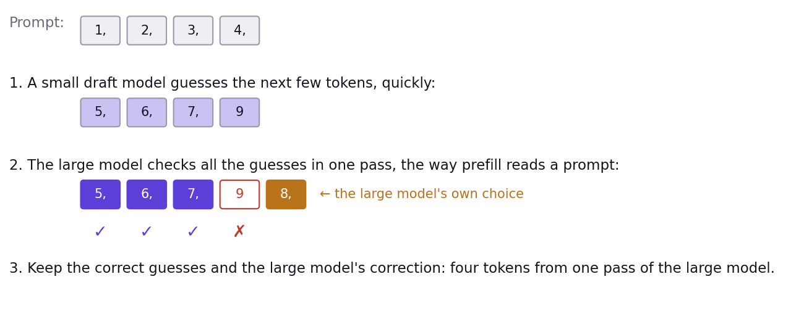

# What you measured is still true at scale

- Prefill is compute-bound and decode is memory-bound, on one chip and on a thousand.
- The KV cache is still what makes generating text affordable.
- Batching still buys throughput until something else runs out.
- Fused operations and trace, which you used in Act IV, are how production code removes the cost of every command.

# When the model doesn't fit on one chip

- **Tensor parallelism**: each layer is split across chips, and the chips exchange partial results at every layer.
- Now the network between chips is a second speed limit next to memory bandwidth.
- The napkin math gains a term: bytes exchanged between chips per token.

# Prefill and decode on different chips

- They want different hardware: prefill needs arithmetic, decode needs memory bandwidth.
- **Disaggregated serving**: some chips only prefill, others only decode, and the KV cache travels between them.
- Pointless for a 1.5B model on one card; decisive for a 400B model on a Galaxy.

# Serving many users

- Requests arrive all the time, so batches are rebuilt at every step (**continuous batching**).
- The KV cache is stored in fixed-size **pages**, like virtual memory, so users can come and go.
- A load balancer decides which group of chips gets which request.

# Speculative decoding: why it helps

- Decoding is expensive per token: in Act I, prefill got through hundreds of times more tokens per second than decode.
- But some tokens are easy to predict: after "1, 2, 3, 4," almost anything would guess "5,".
- So a small **draft model**, trained to imitate the large one, guesses the next few tokens quickly. Some models even predict several tokens at once (**multi-token prediction**).
- The large model checks all the guesses in **one** pass, the way prefill reads a prompt, and keeps the correct ones.
- It pays off because decode is memory-bound: checking five tokens costs about as much as generating one.

# Speculative decoding, step by step

# Today's results

- The Speedrun leaderboard.
- The fastest few rerun their race on the projector and show their code.

# So long, and thanks for all the FLOPs

- Everything you used today is open source: tt-metal, TT-NN, tt_transformers.
- The notebooks, with the answers for Acts 0 to III, are yours to keep.
- Questions.
